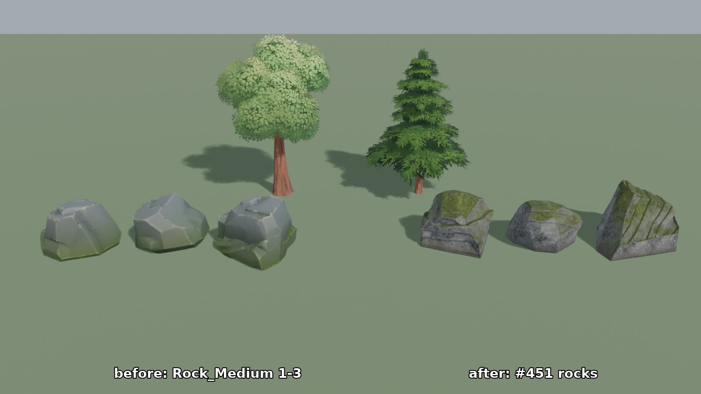
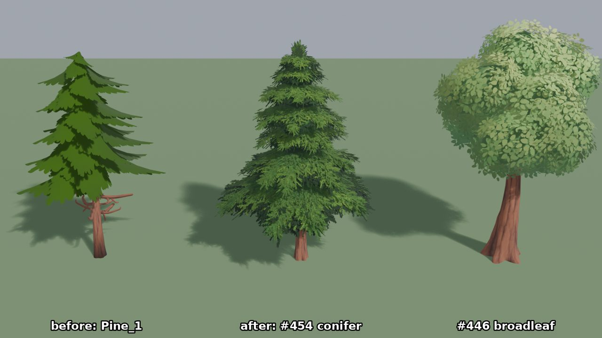
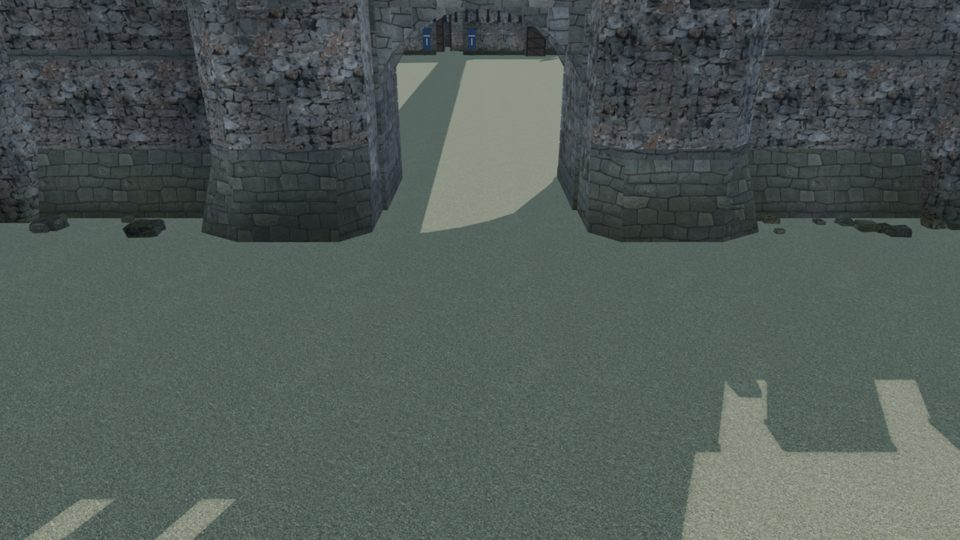

# Asset style references

Use these **existing, project-rendered captures** as quick visual anchors before altering a character, material, prop or environment kit. They are linked in place from `review/` rather than copied into a second image store. All captures are examples of a *specific artifact and camera*, not automatic approval of the current asset or a universal style across games.

1. Choose the consumer and its style family first: MMORPG/ARPG humanoids are humanlike; My Farm characters are deliberately cartoony ([Atlas 1.1.4](../decisions/atlas.md)).
2. Inspect the matching reference below, then compare the **new** output at the same approximate game-camera scale. A standalone Blender beauty render is supplementary, not consumer evidence.
3. Show a current-versus-candidate image under the consuming game's review issue, naming the exact bundle/build and capture, before asking the owner to approve replacement ([Atlas 7.1.6](../decisions/atlas.md)). Do not treat a reference image's existence as approval to deploy.

## Greyhaven: rocks and vegetation

- **Use for:** rock silhouette, edge wear, moss placement and readability beside Greyhaven's trees at game scale; keep distinct silhouettes, not recolored duplicates.
- **Source:** project-rendered before/after capture for [Greyhaven rock #451](https://github.com/moritzbrantner/asset-tooling/issues/451), stored as `review/greyhaven-nature/rock-451-game.jpg`. Compare the close-up separately in [`rock-451-close.jpg`](../../review/greyhaven-nature/rock-451-close.jpg).
- **Rights:** self-rendered project comparison; source meshes and images are derived from Quaternius Stylized Nature MegaKit and Poly Haven resources catalogued with `CC0-1.0` evidence in [`catalog/sources.json`](../../catalog/sources.json). The screenshot is an internal authored review image, not a separately licensed upstream photo.

- **Use for:** tree crown density, branch contrast, trunk proportion and silhouette against other Greyhaven nature assets; compare the actual new LOD from several distances.
- **Source:** project-rendered game-camera comparison for [conifer #454](https://github.com/moritzbrantner/asset-tooling/issues/454), stored as `review/greyhaven-nature/conifer-454-game.jpg`. A broadleaf context comparison is in [`broadleaf-446-woods-mid.jpg`](../../review/greyhaven-nature/broadleaf-446-woods-mid.jpg).
- **Rights:** self-rendered project review; underlying Quaternius/Poly Haven source members recorded as `CC0-1.0` in [`catalog/sources.json`](../../catalog/sources.json).

## Fortress: stone, timber and readable structure

- **Use for:** masonry scale, dark mortar, worn stone, arches, material cohesion and believable collision-facing structures in the fantasy fortress family. Do not import this entire finish into every game's architecture.
- **Source:** project-rendered game-camera capture for [fortress kit #445](https://github.com/moritzbrantner/asset-tooling/issues/445), stored as `review/fortress-kit/game-gate.jpg`; see also [`game-wallwalk.jpg`](../../review/fortress-kit/game-wallwalk.jpg) for stone/timber walkways and [kit material recipes](../fortress-kit.md).
- **Rights:** self-rendered project review; the kit uses the Poly Haven `broken_wall`, `japanese_stone_wall`, `stone_tiles_02` and `old_planks_02` CC0-1.0 inputs recorded in [`catalog/sources.json`](../../catalog/sources.json).

## Still needed before #396 can close

These links deliberately do **not** pretend that the complete visual reference set exists:

- **Characters (Marshal style):** capture the current *male Ranger, female Ranger and Tanner Hilda* from front, side and back in a fixed camera/lighting rig. Show long robes, practical boots and garment fit in motion; link to the captured artifact and source/gear licenses. The live [Ranger comparison route](../animation-viewer.md#ranger-comparison) is useful for inspection, but it follows a rolling release and is not an immutable reference image.
- **Materials:** add handhold wear, timber/palisade and cloth/leather game-camera close-ups tied to actual source and finish recipe; generic texture swatches alone are insufficient.
- **Props and kits:** capture the *shrine*, *outpost* and *settlement props* under a matching game camera, so they can be compared without introducing a second gallery. The fortress images above cover only the fortress family.

Keep future reference images in the existing `review/<family>/` folders; link them here with source, license, named consumer and intended comparison. No paid/copyrighted game art, unsourced mood boards, automatic owner approval or new reference-image storage pipeline.
