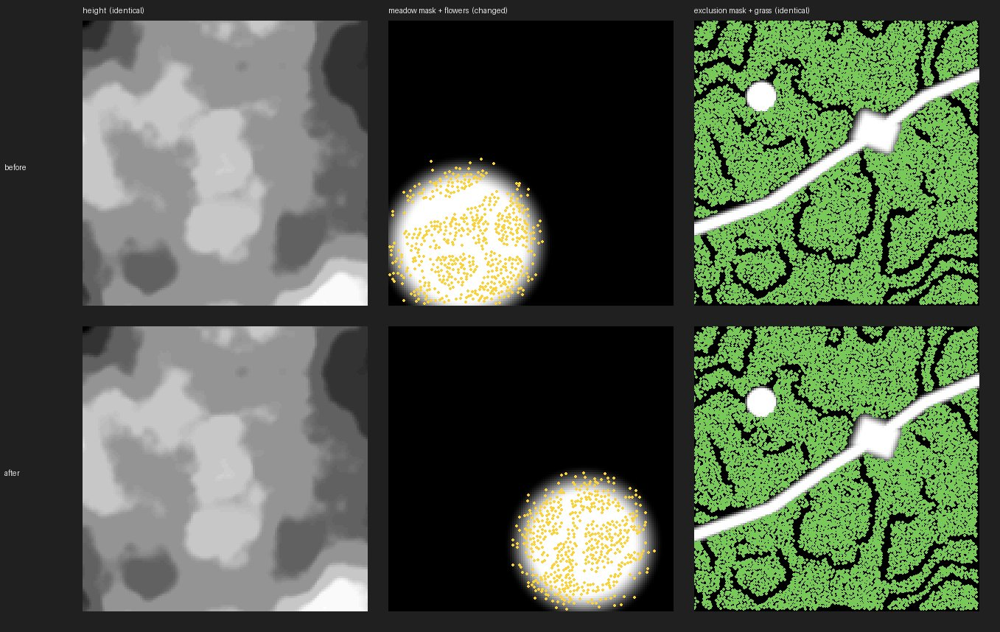

# Terrain patches and detail scatter

`asset-tooling/recipes/terrain-patches` ([`src/terrain-patch-recipes.ts`](../src/terrain-patch-recipes.ts)) generates editable heightfield patches, their masks and meshes, and cosmetic detail instances from one versioned recipe (#134). Everything is a pure function of world position, so a patch never reads its neighbours, and patches can be built in any order, alone or all together, with identical bytes.

It produces assets, not game terrain. The game owns world placement, streaming, blending and collision. A game that wants real traversable height has to feed the same recipe, or the exported heights, into its own terrain and physics. A flat-grid game can use the masks and detail as surface textures or scenery that can't be walked on. It must never draw a displaced floor above unchanged collision.

```ts
import { generateTerrainPatch, scatterTerrainDetail, terrainPatchGlb, encodeGrayPng, TERRAIN_PATCH_PRESETS } from "asset-tooling/recipes/terrain-patches";

const patch = generateTerrainPatch(recipe, [0, -1]);   // patch index, may be negative
const detail = scatterTerrainDetail(patch);
const glb = await terrainPatchGlb(patch);
const heightPng = encodeGrayPng(patch.width, patch.depth, patch.heights);
```

## Recipe

Every field is required; `normalizeTerrainPatchRecipe` rejects unknown, missing or out-of-range fields. `TERRAIN_PATCH_PRESETS` holds complete `flat`, `rolling`, `island` and `terrace` recipes to copy and edit.

| Field | Meaning |
| --- | --- |
| `seed` | uint32 seed for the noise. In `schemaVersion` 1 it also seeds every detail layer; `schemaVersion` 2 gives each detail layer its own `seed` (see [seed groups](#seed-groups-and-partial-rebuilds)). |
| `origin` | World X/Z in metres of global sample (0, 0). |
| `sampleSpacing` | Metres between samples (0.01–64). |
| `samples` | Vertex samples per patch along X and Z (2–257). Neighbouring patches share one edge row or column. |
| `height` | `min`, `max` and `precision` in metres. Heights are stored as `round((h − min) / precision)` in 16 bits, so `(max − min) / precision` must be at most 65535. A terrain sample outside `min..max` fails the build instead of being clamped. |
| `noise` | Value-noise fBm at world coordinates: `baseHeight`, `amplitude` (metres), `featureSize` (metres for the largest octave), `octaves` (1–8) and `roughness` (amplitude kept per octave, 0–1). |
| `shaping` | `noise` (as is), `island` (blend to `seaLevel` outside `radius` around `center`, over `falloff` metres) or `terrace` (`step` metres per level, `sharpness` 0–0.95 for how much of each step is flat). |
| `edits` | Applied in order after shaping. `flatten` blends to `height` inside a shape. `path` levels each cross-section of a polyline to the height its centreline had before this edit, over `width` plus `falloff`. Either can set `excludeDetail`. |
| `exclusions` | Shapes that only exclude detail. |
| `paint` | Named paint masks, each a list of shapes. |
| `detail` | Detail layers (below). |

Shapes are `circle` (`center`, `radius`), `rect` (`center`, `size`, `rotationDegrees`) or `polyline` (`points`, `width`), each with `falloff` metres. Their weight is 1 inside, smoothsteps to 0 across the falloff and is 0 beyond.

## Patches, sampling and borders

Patch `(px, pz)` starts at global sample `(px·(samplesX − 1), pz·(samplesZ − 1))`. Sample `(gx, gz)` sits at `origin + (gx, gz)·sampleSpacing`, and every patch uses that one expression, so a shared edge has the same coordinates, heights and masks bit for bit. Normals are central differences of the quantized heights. At a patch border they read the sample just outside the patch from the same world function, so shared edges also share normals. Patches of different resolutions are not stitched. That waits for a consumer that needs mixed LODs, and belongs with the geometry owner.

A patch has:

- `heights`: `Uint16Array` of height steps, row-major (rows advance +Z, columns +X)
- `normals`: unit normals, three floats per sample
- `slope`: Q8 slope, `round(angle / 90° × 255)`
- `exclusion`: Q8 maximum of the `exclusions` and every edit with `excludeDetail`
- `paint`: a Q8 mask for each paint layer

`encodeGrayPng` writes a deterministic linear grayscale PNG: 16-bit for heights, 8-bit for masks. `terrainPatchGlb` writes one node translated to the patch origin, with positions local to it, the computed normals, a white `COLOR_0` and one material (`terrain` by default). Each cell is split along its (i, j)–(i+1, j+1) diagonal. There are no UVs: sample terrain materials at world X/Z, as the [Greyhaven terrain](greyhaven-terrain.md) layers expect, so they continue across patches.

## Detail scatter

Each detail layer has `id`, `seed` (schema 2 only), `density` (instances per m²), `minSpacing`, `slopeDegrees` and `height` ranges, `maxExclusion` (instances where the exclusion weight is above it are dropped), `paint` (a paint layer name or `null`; a candidate survives with probability equal to the paint weight), `scale` range and `variants` count.

The layer divides the world into square cells of side `max(minSpacing, 1/√density)`. A cell is occupied with probability `density × cell²` and then holds one candidate anywhere inside it. Of two candidates closer than `minSpacing`, the one with the lower hash priority is dropped, so the realised density falls below `density` as `density × minSpacing²` approaches 1. That product must be at most 1. Occupancy, position, priority, yaw, scale and variant come only from the seed, layer and cell, and the spacing test reads the raw candidates, so slope, height, exclusion and paint filters only remove detail. A localized edit removes nearby detail, but never moves or adds detail elsewhere. Detail near an edit keeps its X/Z and follows the edited surface height.

An instance's ID is `<layer>:<cellX>:<cellZ>`. A patch owns the candidates in its half-open extent `[origin, origin + (samples − 1)·sampleSpacing)`, so adjacent patches split detail without gaps or duplicates. Heights and slopes come from the mesh triangle under the point. Different layers don't keep spacing from each other.

Scatter density is a recipe choice. For walk-through card cover, the [kit standard](kit-standard.md#geometry-and-lods) has the game stop drawing it at 60 m.

## Example

```sh
bun examples/terrain-patches/build.ts              # writes .artifacts/terrain-patches/
python3 examples/terrain-patches/review.py .artifacts/terrain-patches review/terrain-patches/masks.jpg
```

[`examples/terrain-patches/recipe.json`](../examples/terrain-patches/recipe.json) is a 128 m terraced hillside made of four 65×65 patches at 1 m spacing, with a flattened building pad, a path, an excluded circle, a meadow paint mask and three detail layers (grass, meadow flowers and stones on steep risers). The build generates the patches in two orders and checks that every file is identical, compares the heights and normals on every shared edge, and checks that detail IDs are unique. Each `patch_<x>_<z>/` holds `height.png`, `slope.png`, `exclusion.png`, `paint-meadow.png`, `mesh.glb` and `detail.json`, and `manifest.json` lists their hashes and detail counts.

`review/terrain-patches/` holds the four patches rendered together, with detail as coloured markers (`overview.jpg`), the Greyhaven game camera (12 m, 0.42 rad pitch, 50° FOV) looking across the patch seams (`game.jpg`), and the stitched masks (`masks.jpg`). They show the recipe's shape and distribution, not finished art: the game supplies the ground materials and detail meshes.

`bun test test/terrain-patch-recipes.test.ts` covers shared edges in either generation order, negative patches, full against incremental rebuilds, a naive resampling reference, detail partition and minimum spacing across a seam, stable detail and heights after a localized edit, slope, height, paint and exclusion limits, all-excluded scatter, path levelling, invalid and out-of-range recipes, and the GLB and PNG outputs of every preset.

## Seed groups and partial rebuilds

Changing one part of the terrain should not regenerate the rest (#139). Two things make that possible.

**Seed groups.** In `schemaVersion` 2 the recipe `seed` drives only the height noise, and every detail layer has its own required `seed`. Reseeding grass then moves the grass and nothing else. A layer's candidates derive from its seed, its `id` and the cell, never from its position in the list, so reordering layers changes no instance. A schema-1 recipe stays valid and unchanged. Converting it to schema 2 by giving every layer the old `seed` produces the same bytes and the same component keys.

**Components.** `buildTerrainPatchFiles(recipe, patch, { previous, preserve })` builds a patch as separate components. Each one has a key, the SHA-256 of the inputs it actually reads:

| Component | Files | Depends on |
| --- | --- | --- |
| `height` | `height.png`, `slope.png`, `mesh.glb` | the patch grid, `id`, `seed`, `height`, `noise`, `shaping` and the edit geometry (not `excludeDetail`) |
| `exclusion` | `exclusion.png` | the edits with `excludeDetail` and `exclusions` |
| `paint.<name>` | `paint-<name>.png` | that paint layer's shapes |
| `detail.<layer>` | its instances in `detail.json` | the layer's settings and seed, the `height` key, the exclusion inputs and its own paint layer |
| `detail` | `detail.json` | the layer keys, in recipe order |

The function writes nothing. It returns the files, a build record (`terrain-patch-build-v1`: each component's key and output hashes) and `stages.executed` / `stages.reused`. Pass the previous record and a reader for its files as `previous`. A component is reused only when its key is unchanged and its earlier bytes still match their recorded SHA-256. Missing, corrupt or half-written files are regenerated. A reused height is decoded from `height.png`, and `heightSamplesEvaluated` reports 0, so a palette or mask edit provably skips the noise rather than recomputing equal bytes. The result is always byte-identical to a cold build of the same recipe.

`preserve` lists components that must be reused. If one cannot be, because its inputs changed or its bytes don't verify, the build fails before returning anything. A noise edit with `preserve: ["height"]` is refused, not approximated. Detail on top of a changed height always moves with it, so there is no way to keep detail and change the ground under it.

Some edits and what they rebuild:

| Edit | Executed | Reused |
| --- | --- | --- |
| move a paint shape | `paint.<name>`, the layers that read it, `detail` | `height`, `exclusion`, the other layers |
| reseed one layer (schema 2) | that layer, `detail` | everything else |
| toggle an edit's `excludeDetail` | `exclusion`, every layer, `detail` | `height`, paint |
| change `noise`, `shaping`, `seed` or an edit's shape | `height`, every layer, `detail`, plus `exclusion` when the edit excludes detail | paint |

`bun examples/terrain-patches/build.ts [outDir] [recipe.json]` uses this. It reads the previous `manifest.json`, whose patches now carry their `components` records, rebuilds what changed, checks every file against a clean reference build and prints the counts of executed and reused components, height samples evaluated and files and bytes written. Rebuilding the hillside after [`recipe-meadow-moved.json`](../examples/terrain-patches/recipe-meadow-moved.json) moves the meadow executes 12 components and reuses 16, evaluates no height samples and rewrites 7 files. `python3 examples/terrain-patches/partial-review.py <before> <after> <board.jpg>` draws the two builds side by side:



`bun test test/terrain-patch-partial-rebuild.test.ts` covers cold parity with the whole-patch path and between schema 1 and 2, paint edits, reseeding one layer, height edits and refused locks, corrupt and missing files, and an edit sequence (reorder, add, remove, reseed, undo, interrupted write) whose every step matches a clean build.

This covers terrain patches only. Trees (keeping trunk and branches while reseeding foliage), rock outlines under new surface detail and the workbench's lock and reseed controls are still open under #139.
