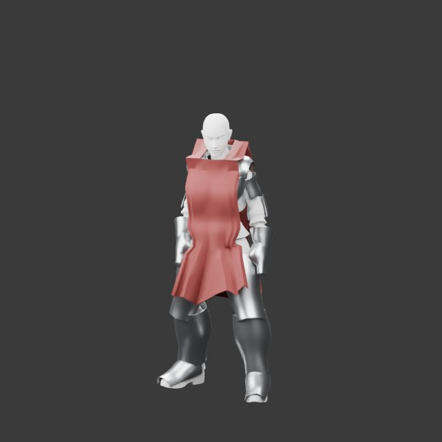
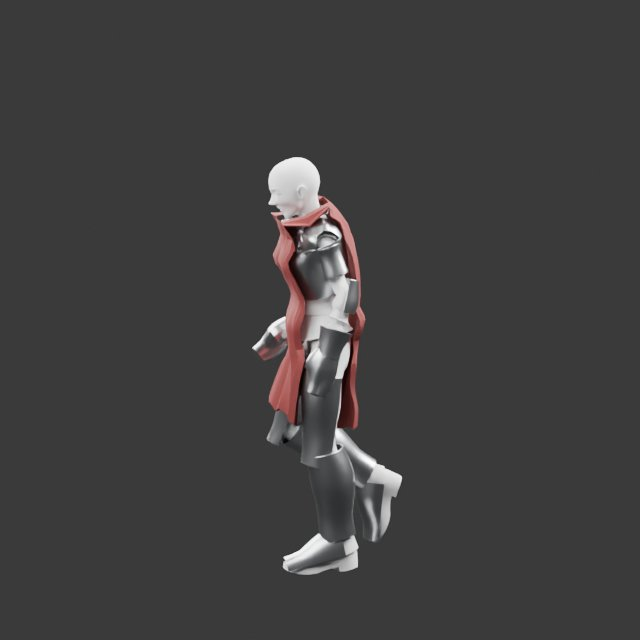
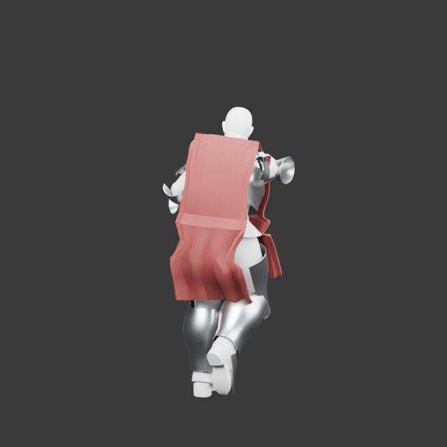

# Female knight fit (#630)

Live Blender review of the existing female Ranger rig in `outfit.knight`, with its fitted `armor.knight`
plates. The source is the catalogued CC0 Quaternius Female_Peasant/UBC female base; armor is the existing
original knight recipe. This is supplementary fitting evidence, not a real Greyhaven capture or owner approval.
The display removes compressed skin/cloth textures to show contours; exported bundles retain their textures.

The armor outfit declares `physiqueFit.bodyMorphScale: 0.35`: non-head garment/plate fields keep continuous
35% responses. The face/jaw keep full strength. The male bascinet is omitted because its cheek rim did not
fit the full female face/build range. No female headwear or other female class wardrobe is claimed.

| Shape | Influences (unlisted targets are zero) |
| --- | --- |
| neutral | all zero (normalized controls at 0.5) |
| curvy | bust.full, waist.narrow, hips.wide, glutes.full = 1 |
| lower | frame.narrow, muscularity.soft, shoulders.narrow, waist.narrow, hips.narrow, glutes.small, jaw.receding, bust.small, build.lean = 1 |
| upper | frame.broad, muscularity.defined, shoulders.broad, waist.wide, hips.wide, glutes.full, jaw.projected, bust.full, build.heavy = 1 |

Each shape has `*-idle.jpg` (`Idle_Loop`, frame 12), `*-walk.jpg` (`Walk_Loop`, frame 7) and
`*-attack.jpg` (`Sword_Slash_Mid_C`, frame 7), at front, side and back angles respectively. These are
sampled pose checks, not an exhaustive sweep of every clip/frame. No exposed-body penetration or detached
plates was visible in these reviewed samples. The fitted under-clothes remain present; coverage lists
remove no additional body parts. The restrained armored silhouette intentionally differs less than the
Ranger/tunic base. Four shapes × three poses were inspected in the owner's live Blender.

`neutral-game-scale.jpg` and `upper-game-scale.jpg` use a supplementary 12 m, 0.42 rad pitch, 50° FOV
camera at 1280×720. They do not include the consumer world's environment, hair selection or lighting.
The consumer still owns real browser/native game-camera acceptance under mmorpg#635.

The reviewed final female tar is `e03978d7dd019cf6e7d60d3bf85ce0ecc51153133414394c3e12062fd6238776`.
The exported descriptor declares 15 plates, 179 shared clips and 18 body targets. A comparison of the
seven retained pre-export source meshes found zero drift in joint-world and inverse bind matrices;
normal download packing still uses the existing quantization/compression path.
